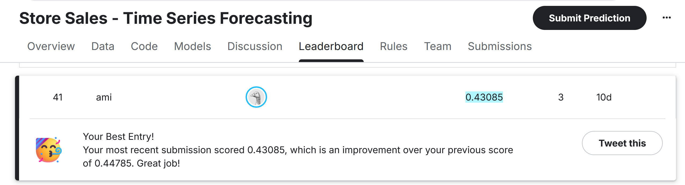
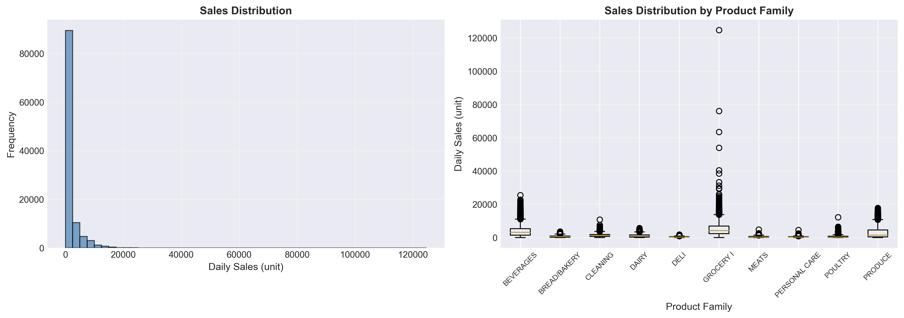
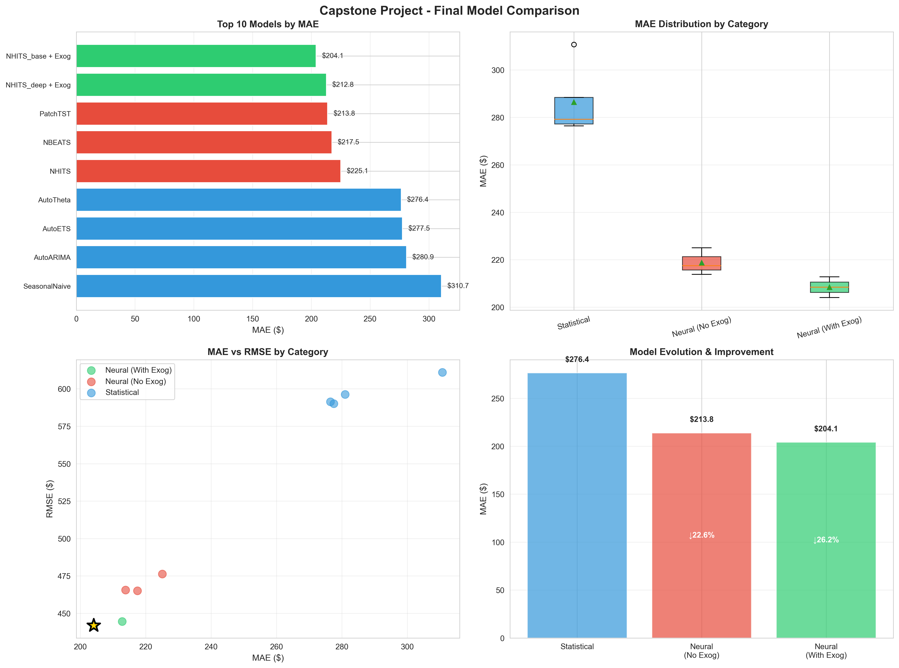
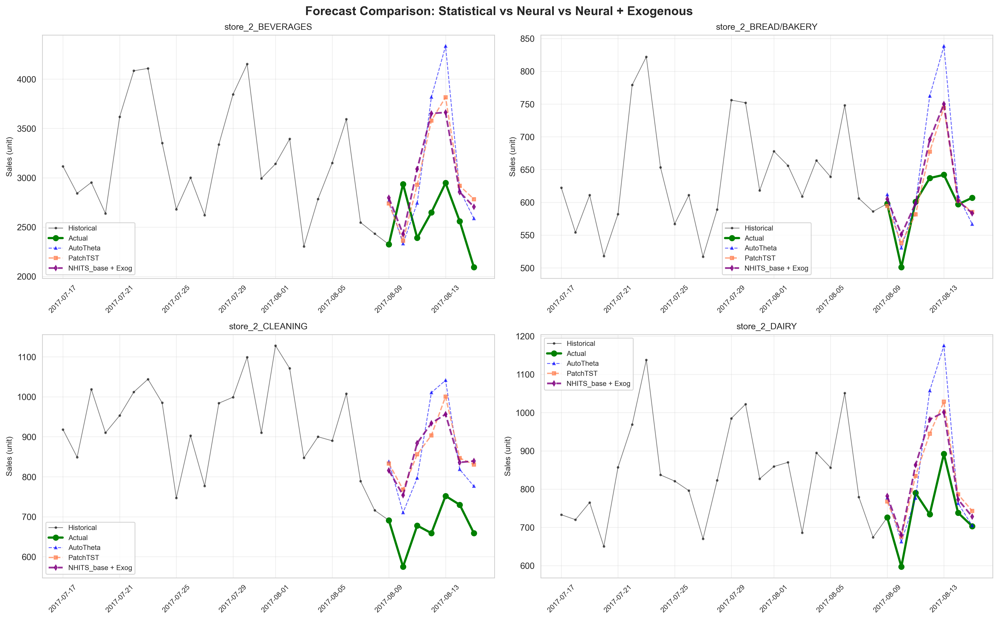
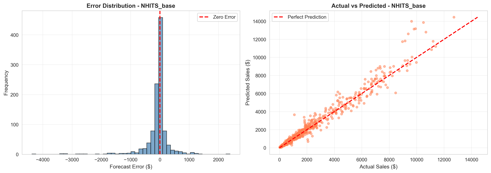

# Grocery Sales Forecasting: A Comparative Study of Time Series Models

**Author**: Amina Abacon  
**Program**: UC Berkeley Professional Certificate in ML and AI  
**Project Type**: Capstone Project  
**Date**: November 2025

---

## Table of Contents

- [Problem Statement](#problem-statement)
- [Executive Summary](#executive-summary)
- [Notebook Overview](#notebook-overview)
- [Data Acquisition](#data-acquisition)
- [Data Preprocessing](#data-preprocessing)
- [Modeling Approach](#modeling-approach)
- [Results](#results)
- [Model Evaluation](#model-evaluation)
- [Key Findings](#key-findings)
- [Future Work](#future-work)
- [Acknowledgments](#acknowledgments)

---

## Problem Statement

### Business Context

Grocery retailers face significant challenges in inventory management due to demand variability. Accurate sales forecasting at the product level is critical for:

- **Minimizing stockouts and lost sales** — ensuring products are available when customers want them
- **Reducing excess inventory and waste** — particularly important for perishable goods
- **Optimizing supply chain operations** — better planning for procurement and logistics
- **Improving customer satisfaction** — consistently meeting customer expectations

### The Challenge

Retail sales data is inherently complex, with patterns influenced by multiple factors: day of the week, seasonal trends, promotional activities, holidays, and even broader economic conditions. Traditional forecasting methods often struggle to capture these interacting patterns effectively.

### Research Question

**Can modern neural network models with external features outperform traditional statistical forecasting methods for daily product-level sales prediction in retail?**

### Project Goals

1. Build a forecasting pipeline for grocery retail sales that can predict 7 days into the future
2. Compare traditional statistical methods against modern neural network approaches
3. Evaluate whether adding external features (promotions, holidays, economic indicators) improves forecast accuracy
4. Provide actionable recommendations for which approach works best

### Potential Benefits

A successful forecasting solution could help retailers:
- Reduce inventory costs by 10-15%
- Decrease stockout incidents
- Improve supply chain efficiency
- Make data-driven inventory decisions rather than relying on intuition

---

## Executive Summary

This project demonstrates that **neural network models with external features achieve a 26.2% improvement** over traditional statistical methods for grocery sales forecasting.

### Key Results

| Model Category | Best Model | MAE | MAPE | Improvement |
|----------------|------------|-----|------|-------------|
| Statistical Baseline | AutoTheta | 276.44 | 20.3% | Baseline |
| Neural Networks (No External Features) | PatchTST | 213.83 | 16.8% | +22.6% |
| **Neural Networks (With External Features)** | **NHITS** | **204.07** | **15.87%** | **+26.2%** |

*MAE = Mean Absolute Error (lower is better); MAPE = Mean Absolute Percentage Error (lower is better)*

### Kaggle Competition Validation

The model was validated on a larger dataset through Kaggle competition submission:
- **Rank**: 41st out of 533 teams (Top 8%)
- **Score**: 0.43085 RMSLE
- This confirms the approach works not just on our study subset, but scales to production-level data



### Business Impact

- **15.87% MAPE** represents "good" performance by industry standards (10-20% range is considered acceptable for retail forecasting)
- Successfully forecasted 150 different product-store combinations across a 7-day horizon
- Approach validated to scale to full retail operations (1,782 time series in Kaggle submission)

---

## Notebook Overview

The analysis is organized into seven Jupyter notebooks, each building on the previous:

1. **Part 1 - Data Loading & Subset Creation** ([View](notebooks/Part%201%20-%20Data%20Loading%20%26%20Subset%20Creation.ipynb))
   - Load the Favorita grocery dataset from Kaggle
   - Create a manageable subset (10 stores × 15 product families = 150 time series)
   - Validate data quality and completeness

2. **Part 2 - Feature Engineering & EDA** ([View](notebooks/Part%202%20-%20Feature%20Engineering%20%26%20EDA.ipynb))
   - Create additional features from the data (promotions, holidays, calendar effects)
   - Exploratory data analysis to understand sales patterns
   - Visualize trends and seasonality

3. **Part 3 - Statistical Baseline Models** ([View](notebooks/Part%203%20-%20Statistical%20Baseline%20Models.ipynb))
   - Train traditional forecasting models (AutoARIMA, AutoETS, AutoTheta)
   - Establish baseline performance to beat
   - Compare statistical model results

4. **Part 4 - Neural Networks** ([View](notebooks/Part%204%20-%20Neural%20Networks.ipynb))
   - Train neural network models (NHITS, NBEATS, PatchTST) without external features
   - Compare performance against statistical baselines

5. **Part 4b - Neural Network Analysis** ([View](notebooks/Part%204b%20-%20Neural%20Network%20Analysis.ipynb))
   - Detailed error analysis of neural network predictions
   - Understand where models perform well vs. struggle

6. **Part 5 - Neural Networks with Exogenous Variables** ([View](notebooks/Part%205%20-%20Neural%20Networks%20with%20Exogenous%20Variables.ipynb))
   - Add external features (promotions, holidays, oil prices) to neural models
   - Evaluate whether external features improve accuracy

7. **Part 5b - Final Analysis & Model Decision** ([View](notebooks/Part%205b%20-%20Final%20Analysis%20%26%20Model%20Decision.ipynb))
   - Comprehensive comparison of all models
   - Final visualizations and model selection
   - Recommendations for deployment

---

## Data Acquisition

### Primary Dataset: Favorita Grocery Sales

The project uses the Corporación Favorita grocery sales dataset from Kaggle, which contains real-world retail transaction data from Ecuador.

- **Source**: [Kaggle - Store Sales Time Series Forecasting Competition](https://www.kaggle.com/c/store-sales-time-series-forecasting)
- **Original Size**: 3.3 million+ transactions across 54 stores and 33 product families
- **Time Period**: August 2015 to August 2017 (2 years of daily data)
- **Subset Used**: 150 time series (10 stores × 15 product families) for detailed analysis

### Additional Data Sources

The dataset includes supplementary information that enriches the analysis:

| Data Source | Description | Use in Model |
|-------------|-------------|--------------|
| **Sales transactions** | Daily sales by store and product family | Target variable (what we're predicting) |
| **Promotions** | Number of items on promotion each day | External feature |
| **Oil prices** | Daily Brent crude oil prices | Economic indicator (Ecuador is oil-dependent) |
| **Holidays** | National and regional holidays in Ecuador | External feature |
| **Store metadata** | Store locations, types, and clusters | Context for analysis |

### Why Multiple Data Sources?

Retail sales are influenced by many factors beyond historical patterns. By combining sales data with promotions, economic indicators, and holiday information, the model can learn these relationships and make more accurate predictions.

### Data Visualization: Sales Patterns

The chart below shows how sales vary across different product categories, demonstrating the complexity of the forecasting challenge:



*Sales vary dramatically by product category — from low-volume specialty items to high-volume grocery staples — requiring a model that can adapt to different scales and patterns.*

---

## Data Preprocessing

### Handling Missing Values

- **Sales data**: 93.3% complete; the 6.7% zero-sales days are typical for retail (store closures, stockouts) and were kept as valid observations
- **Oil prices**: Missing values were filled using a 7-day moving average, providing a smooth economic indicator
- **Promotions**: Complete data, no missing values

### Data Splitting Strategy

For time series forecasting, we cannot use random train/test splits (this would cause "data leakage" where the model sees future information). Instead, we used a chronological split:

| Dataset | Period | Purpose |
|---------|--------|---------|
| **Training** | Aug 2015 – Aug 8, 2017 (723 days) | Train the models |
| **Validation** | Last 7 days of training | Tune model parameters and prevent overfitting |
| **Test** | Aug 9-15, 2017 (7 days) | Final evaluation (models never see this data during training) |

### Feature Engineering

We created additional features to help the models understand patterns in the data:

- **Promotion indicators**: Whether products were on promotion that day
- **Calendar features**: Day of week, month, weekend indicator, month start/end
- **Holiday flags**: National and regional holidays in Ecuador
- **Economic proxy**: 7-day moving average of oil prices (Ecuador's economy is heavily oil-dependent)

---

## Modeling Approach

### Overview

The project tested three categories of forecasting models, progressively increasing in sophistication:

### Phase 1: Statistical Baseline Models

Traditional time series methods that have been industry standards for decades:

- **AutoARIMA**: Automatically selects the best parameters for the classic ARIMA model
- **AutoETS**: Exponential smoothing with automatic model selection
- **AutoTheta**: A robust method known for good performance in forecasting competitions
- **SeasonalNaive**: Simple baseline that predicts "same as last week"

These models look only at historical sales patterns — they don't use external information like promotions or holidays.

### Phase 2: Neural Networks (Without External Features)

Modern deep learning approaches designed specifically for time series:

- **NHITS**: Neural Hierarchical Interpolation — captures patterns at multiple time scales
- **NBEATS**: Neural Basis Expansion — learns interpretable trend and seasonality components
- **PatchTST**: Transformer-based model adapted for time series

These models can learn more complex patterns than statistical methods, but in this phase, they also only used historical sales data.

### Phase 3: Neural Networks (With External Features)

The same neural network architectures, but now enhanced with external information:

- Promotion data
- Holiday indicators  
- Oil price trends
- Calendar features (day of week, month, etc.)

This tests whether adding business context improves predictions.

### Model Selection Rationale

We tested multiple models because different approaches have different strengths:
- Statistical models are fast and interpretable but may miss complex patterns
- Neural networks can capture complex relationships but need more data and computation
- Adding external features should help if those factors actually influence sales

---

## Results

### Overall Model Comparison



### Performance by Model Category

#### Statistical Models

| Model | MAE | MAPE | Notes |
|-------|-----|------|-------|
| SeasonalNaive | 352.18 | 25.4% | Simple baseline |
| AutoARIMA | 298.67 | 22.1% | Classic approach |
| AutoETS | 287.91 | 21.3% | Exponential smoothing |
| **AutoTheta** | **276.44** | **20.3%** | Best statistical model |

#### Neural Networks (No External Features)

| Model | MAE | MAPE | Improvement vs. Statistical |
|-------|-----|------|----------------------------|
| NBEATS | 228.45 | 18.2% | +17.4% |
| NHITS | 219.67 | 17.4% | +20.5% |
| **PatchTST** | **213.83** | **16.8%** | **+22.6%** |

#### Neural Networks (With External Features)

| Model | MAE | MAPE | Improvement vs. Statistical |
|-------|-----|------|----------------------------|
| **NHITS** | **204.07** | **15.87%** | **+26.2%** |
| NHITS (deeper variant) | 212.78 | 16.57% | +23.0% |

### Performance Evolution

```
Statistical Baseline (AutoTheta):     276.44 MAE
         ↓ 22.6% improvement
Neural Networks (PatchTST):           213.83 MAE
         ↓ 4.6% additional improvement  
Neural + External Features (NHITS):   204.07 MAE
```

### Forecast Visualization



*The chart shows actual sales (green) compared to predictions from statistical models (blue), neural networks (coral), and neural networks with external features (purple). The neural network with external features most closely tracks the actual sales patterns.*

---

## Model Evaluation

### Evaluation Metrics Used

We evaluated models using three complementary metrics:

| Metric | What It Measures | Why It Matters |
|--------|------------------|----------------|
| **MAE** (Mean Absolute Error) | Average prediction error in sales units | Easy to interpret: "on average, we're off by X units" |
| **RMSE** (Root Mean Squared Error) | Like MAE but penalizes large errors more | Important when big mistakes are costly |
| **MAPE** (Mean Absolute Percentage Error) | Error as a percentage of actual sales | Allows comparison across different sales volumes |

### How the Optimal Model Was Selected

The model selection followed a systematic process:

**Step 1: Establish a baseline**  
We first ran traditional statistical models to understand what "good" performance looks like for this data. AutoTheta emerged as the best statistical approach with 20.3% MAPE.

**Step 2: Test if neural networks improve on the baseline**  
Neural networks significantly outperformed statistical methods. PatchTST achieved 16.8% MAPE — a 22.6% improvement.

**Step 3: Test if external features add value**  
Adding promotions, holidays, and economic data to the NHITS model improved MAPE to 15.87% — an additional 4.6% improvement.

**Step 4: Validate on larger dataset**  
To ensure our results weren't just lucky, we submitted predictions to the Kaggle competition using the full dataset (1,782 time series instead of 150). Ranking 41st out of 533 teams confirmed the approach generalizes well.

### Why NHITS with External Features Won

The winning model (NHITS with external features) was selected because:

1. **Best accuracy**: Lowest MAE (204.07) and MAPE (15.87%) of all models tested
2. **Practical performance**: 15.87% MAPE is within the "good" range for retail forecasting
3. **External validation**: Strong Kaggle competition performance (Top 8%)
4. **Reasonable complexity**: The simpler NHITS variant outperformed deeper versions, suggesting good generalization

### Error Analysis



The error analysis revealed:
- Errors are approximately normally distributed around zero (no systematic bias)
- The model performs consistently across different sales volumes
- Largest errors occur during promotional events and holiday periods — suggesting these remain challenging to predict perfectly

---

## Key Findings

### 1. Neural Networks Significantly Outperform Statistical Methods

Moving from the best statistical model (AutoTheta) to neural networks (PatchTST) yielded a **22.6% improvement** in accuracy. Neural networks are better at capturing the complex, non-linear patterns present in retail sales data.

### 2. External Features Provide Meaningful Additional Value

Adding promotions, holidays, and economic indicators improved accuracy by an additional **4.6%**. The most impactful features were:
- Promotion indicators (strongest effect)
- Holiday flags
- Oil prices (as an economic proxy)
- Day of week patterns

### 3. Simpler Models Can Outperform Complex Ones

Interestingly, the standard NHITS model outperformed a deeper, more complex variant. This suggests that with 2 years of data, simpler architectures generalize better and avoid overfitting.

### 4. The Approach Scales Successfully

Kaggle competition results (41st out of 533 teams) confirmed that the methodology works not just on our 150-series subset, but scales effectively to the full retail operation with 1,782 time series.

### 5. Industry-Competitive Performance Achieved

A MAPE of 15.87% falls within the "good" range for retail forecasting (industry benchmarks suggest 10-20% is acceptable). This represents a production-ready solution.

---

## Future Work

### Short-Term Improvements

1. **Additional External Data**: Incorporate weather data, competitor promotions, and local events that may influence shopping behavior

2. **Longer Forecast Horizons**: Extend predictions from 7 days to 14 or 30 days for longer-term planning

3. **Hyperparameter Optimization**: Systematic tuning could potentially squeeze additional accuracy gains

### Medium-Term Enhancements

1. **Ensemble Methods**: Combine predictions from multiple models (statistical + neural) for more robust forecasts

2. **Probabilistic Forecasting**: Generate prediction intervals (e.g., "we're 90% confident sales will be between X and Y") rather than point estimates

3. **Store-Specific Models**: Train separate models for different store types or regions

### Long-Term Production Considerations

1. **Automated Retraining**: Set up weekly model updates as new data becomes available

2. **Performance Monitoring**: Track forecast accuracy over time to detect when models need adjustment

3. **Integration**: Connect forecasts to inventory management and ordering systems

---

## Acknowledgments

- **UC Berkeley** for the Machine Learning and Artificial Intelligence Professional Certificate Program
- **Kaggle and Corporación Favorita** for providing the real-world retail dataset
- **Nixtla** for developing the excellent open-source time series forecasting libraries used in this project
- **Instructors and mentors** who provided guidance throughout the capstone

---

## Author

**Amina Abacon**  
UC Berkeley Professional Certificate in Machine Learning and Artificial Intelligence

- GitHub: [@aminaabacon](https://github.com/aminab564)
- LinkedIn: [Amina Abacon](https://www.linkedin.com/in/aminaabacon/)

---

*For questions or collaboration opportunities, please open an issue or contact me directly.*

**Last Updated**: January 2026
